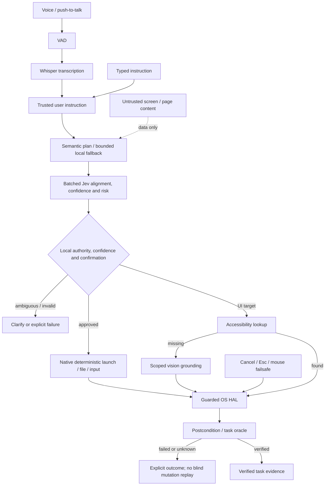

# WisprHelp reliability and validation report

Audit/evaluation date: **2026-10-11** (Asia/Calcutta). Host: Windows 11, Python 3.14.3.
This report evaluates the working tree, including edits that already existed before
this task. It does not attribute those earlier edits to this reliability work.

## Verified audit findings

| Observation | Evidence and conclusion |
|---|---|
| Claimed end-to-end coverage | `tests/test_end_to_end.py` supplies strings in place of recorded speech, uses `MagicMock` HALs and disabled HUD/audio. It is mocked pipeline integration. |
| Cross-platform support | Three adapter classes exist. Windows has UIA text access; macOS has limited AppleScript lookup; Linux had guessed coordinates from an xdotool window position, not AT-SPI button lookup. Adapter existence does not establish GUI reliability. |
| README links | Windows `file:///d:/WishperHelp/` links were confirmed and replaced with relative links. |
| Filename mismatch | The actual roadmap is `implementation_plan.md`; uppercase README references would fail on a case-sensitive checkout. |
| Test counts | README listed both 84 and 140 tests, with no OS task success denominator. Those hardcoded counts were removed. |
| Confirmation parsing | Legacy SafetyGate accepted a positive token inside a negative sentence. Consent now requires a complete explicit phrase, including supported English/Hinglish replies. |
| Confidence handling | Compound decomposition increased returned Jev confidence and the legacy runtime promoted low-confidence compound requests into execution. Both bypasses were removed. Incomplete/invalid numeric classifications now block execution. |
| False completion | Legacy confirmation returned success for unsupported high-risk intents; a nonempty window title counted as a changed title; text verification equated changed pixels with matching text. Those false-success paths were removed. |
| Retry hazards | Failed potentially modifying steps could be retried/replanned. Such steps now stop; recovery is restricted to safe queries/launches or known failures before dispatch. |
| Test side effects | Some default HAL tests actually called paste, capture, or volume functions. Offline tests now isolate clipboard, input, screen pixels, process launch, home directories and external API calls. |

## Current execution contract

Speech still passes through VAD and Whisper; the semantic planner, batched Jev
plan classification, deterministic actions, accessibility, and scoped vision remain.
There is no new model integration. `TranscriptionResult` distinguishes unavailable
transcription from silence while retaining the string API.

`FailureCode` is shared by action, semantic-turn, legacy-runtime and vision results:
`target_app_missing`, `accessibility_target_not_found`, `incorrect_grounding`,
`action_timeout`, `unexpected_modal`, `focus_changed`, `postcondition_failed`,
`api_unavailable`, `invalid_classification`, `low_confidence`, `cancelled`,
`emergency_stop`, `busy`, `step_limit`, `unauthorized`, and a generic `action_failed`.
Not every backend can distinguish every cause: e.g. a failed launcher may mean
missing app or permission denial. Invalid classification is blocked as clarification.

The semantic loop retains a maximum of 15 steps, including retries, with bounded
replans. Input checkpoints check cancellation/emergency, deadlines, unexpected
dialogs where supported, and foreground identity. Launches require a foreground
postcondition. Text replacement/append checks accessible content. Model-only
`finish` output cannot prove success. Screen changes are evidence of response,
not proof of a semantic goal or exact text. Results expose optional postcondition
verification; dispatch-only operations still retain compatibility success semantics.
Only an independent task oracle in the evaluation harness establishes task success.

Destructive planner flags, deletion, content replacement, existing-file overwrites,
known risky controls/keys and terminal typing engage local confirmation. Consent
is bound to the held action, foreground and relevant file/content state, consumed
once, and invalidated when context changes. Create uses exclusive creation. File
move/rename collisions require confirmation. Failed mutations are not replayed.
Unsupported high-risk legacy execution returns a failure and directs callers to
the typed semantic interface.

Cancellation bypasses the turn lock, clears pending consent, cancels queued graph
nodes and signals both vision paths. Overlapping tasks return `busy`; overlapping
voice stop requests are transcribed and forwarded rather than silently dropped.
Emergency stop remains latched. After stopping a coordinator, call its explicit
`reset_abort()` only after the active turn has ended, or restart the CLI. Automatic
abort resets cannot resume a pending destructive workflow.

Cancellation/deadlines are **cooperative**: an already executing native operation
cannot be rolled back, and an in-flight API call must return or time out before
its result is discarded. No <=10ms guarantee is claimed. No background worker is
abandoned while it might still mutate the desktop.

Observed pages, labels, clipboard/retrieved content are untrusted data in prompts.
They cannot supply confirmation. Deterministic plan checks constrain file/terminal
privileges to the user instruction; visual fallback is scoped to an approved action,
and named Set-of-Marks candidates must match its approved target. This reduces
privilege escalation paths but is not a complete prompt-injection security proof.

## Results and task matrix

The initial baseline had **167 passed, 1 skipped, 4 temporary-directory setup errors**,
plus 22 passing subtests. The errors were sandbox access to the default user temp
directory; pytest now uses a dedicated repository-local `.test-tmp` directory.
Final local verification (offline tests, Windows 11 / Python 3.14.3):

| Required command | Result |
|---|---|
| `python -m pytest tests/ -v` | **237 passed, 1 skipped, 22 subtests passed**, 17.06 seconds |
| `python -m pytest tests/test_jev_classification.py -v` | **7 passed**, 0.30 seconds |
| `python -m pytest tests/test_hal_adapters.py -v` | **5 passed**, 0.44 seconds |

The skipped test is the live Groq decomposition test: external services are disabled
in the offline suite. The focused results are subsets of the full suite, not extra
tests to add to the total. Compilation and Git whitespace checks also passed.
Failure/adapter regressions include partial native keyboard failure with key release
and no replay, cancellation while a model is pending, and destructive flags that
must hold execution even when their probability score is inconsistent. Legacy
literal dictation into known terminal processes is blocked; use the semantic
interface for action-bound terminal confirmation. Known risky legacy commands
also hold when the classifier incorrectly labels them safe.

| Task | Layer | OS | Expected outcome | Observed evidence |
|---|---|---|---|---|
| Launch simulated app, type Hindi/emoji, navigate | Mocked HAL + real executor | Windows host | Complete and oracle matches | Passed |
| Missing accessibility control | Mocked | Windows host | Explicit failure, zero input | Passed |
| Missing control with approved alternative | Mocked | Windows host | One bounded recovery, alternate succeeds | Passed |
| Cancellation between steps | Mocked | Windows host | Partial task; next action blocked | Passed |
| Create/append/read isolated Unicode document | Real filesystem, simulated desktop | Windows 11 | Contents match | Passed |
| Attempt overwrite without consent | Real filesystem, simulated desktop | Windows 11 | Hold; original remains | Passed |
| Start disposable GUI fixture | Genuine desktop attempt | Windows 11 | Verify foreground PID/title | Fixture started; guard failed with `focus_changed` |
| Type into isolated GUI editor | Genuine desktop | Windows 11 | Exact fixture oracle text | Not reached |
| Accessibility navigation | Genuine desktop | Windows 11 | Fixture changes to page 2 | Not reached |
| Missing GUI element / cancellation | Genuine desktop | Windows 11 | Zero additional fixture clicks | Not reached |
| Live microphone → STT → Jev → GUI | Live end-to-end | All platforms | Completed OS task | Not run |

Retained machine-readable evidence: [mocked](evaluations/results/windows-mocked.json),
[filesystem](evaluations/results/windows-filesystem.json),
[desktop](evaluations/results/windows-desktop.json).
The GUI environment had pywin32/UIA available and a ready fixture; foreground
verification still failed after a bounded focus attempt. No GUI keyboard/mouse
test input was dispatched. The fixture was closed through its own stop file.

Negative evaluations may pass their safety expectation while the requested task
is failed or partial. Do not combine these with completed task counts. Latencies
are single-run local observations, exclude live speech/model inference, and are
not performance benchmarks. JSON records action counts, recovery attempts, and
blocked risky/unauthorized attempts. The overwrite scenario intentionally records
one blocked risky attempt; no real deletion or unauthorized overwrite is executed.

| Retained task run | Completion | Actions attempted | Input calls | Recovery attempts | Latency (ms) | Blocked risky attempts |
|---|---|---:|---:|---:|---:|---:|
| Mock Unicode/navigation | Successful | 3 | 5 simulated | 0 | 22.067 | 0 |
| Mock missing element | Failed as expected | 1 | 0 | 0 | 0.042 | 0 |
| Mock approved alternative | Successful | 2 | 1 simulated | 1 | 0.052 | 0 |
| Mock cancellation | Partial as expected | 2 | 1 simulated | 0 | 0.044 | 0 |
| Real filesystem create/append/read | Successful | 3 | 0 | 0 | 1.432 | 0 |
| Real filesystem overwrite held | Failed task; safety expectation passed | 1 | 0 | 0 | 0.235 | 1 |
| Windows GUI fixture guard | Failed setup | 0 task actions | 0 test input | 0 | Not measured | 0 |

Mocked mode verified **4/4 expected behaviors** (2 completed tasks, 1 partial, 1
failed); filesystem mode verified **2/2 expected behaviors** (1 completed task,
1 held overwrite). The GUI attempt verified **0 completed GUI tasks**. Harness
startup/focus setup is not counted as an executor task action. Action-call counts
include failed/held attempts; file operations do not count as native input calls.

## Platform evidence

| Feature | Windows | macOS | Linux |
|---|---|---|---|
| Native launch | Implemented; mocked contracts/unit paths; GUI launch completion unverified | `open -a` with exit/timeout checks; mocked contract on Windows; native unverified | Binary/validated desktop launcher; mocked paths; native unverified |
| Foreground/window tracking | Win32 implemented; fixture foreground attempt failed | App name/PID through AppleScript; window geometry is placeholder | xdotool/X11 title/PID; geometry/process information limited |
| Named accessibility lookup | UIA implemented; mocked contracts; genuine GUI task not reached | Limited AppleScript lookup; mocked escaping/timeout contract; native unverified | AT-SPI not implemented; returns None instead of guessed coordinates |
| Focus/read editable text | UIA implemented and mocked | Not implemented for verified editing | Not implemented for verified editing |
| Unicode clipboard paste | Implemented; mocked restoration test | Implemented; mocked restoration test on Windows | Implemented for X11; mocked restoration test on Windows |
| Modal detection | UIA modal/Win32 dialog class, mocked failure tests | Unsupported (returns unknown) | Unsupported (returns unknown) |
| Vision/coordinate checks | Platform-neutral mocked tests; live models not tested | Same code; native capture unverified | Same code; native capture unverified |
| Wayland desktop input | Not applicable | Not applicable | Not implemented/verified |
| Isolated filesystem task integration | Verified here | CI configured, not executed here | CI configured, not executed here |
| Manual end-to-end verification | None in this task | None | None |

[CI](.github/workflows/tests.yml) configures offline contracts and temporary
filesystem evaluations on Windows, macOS and Ubuntu, Python 3.11/3.13. These jobs
have not been executed in this session. Their artifacts are the evidence source
once they run. Hosted/headless runners do not establish interactive desktop,
accessibility-permission, microphone, multi-monitor or Wayland behavior.

## Reproduce and demo

See [evaluations/README.md](evaluations/README.md) for the safe commands, isolated GUI,
requirements and metric definitions. A short no-key demo is:

```bash
python -m evaluations.run --mode mocked
python -m evaluations.run --mode filesystem
```

Run genuine GUI tasks only in the dedicated Windows fixture session described
there. Real app launching, speech recognition, live Jev/VLM availability and
reliability benchmarks remain separate future evaluations.



## Remaining limitations

- No successful real GUI task or live voice/model end-to-end run was established.
- macOS editable-text/geometry coverage and Linux AT-SPI/Wayland coverage are incomplete.
- Coordinate-only vision validates bounds/focus/response, but cannot prove semantic
  target identity as strongly as labeled accessibility candidates.
- Generic keystrokes, UIA clicks, media changes and window operations do not all
  have semantic postcondition oracles; callers must inspect verification metadata.
- OS-level focus races and operations already dispatched cannot be undone by cancellation.
- Local lexical authority/risk checks are conservative and incomplete for arbitrary
  languages/apps. Sensitive credential/password-manager protection needs dedicated
  backend policies; this task does not claim comprehensive coverage.
- The native file executor still lives partly outside HAL; broader restructuring
  was intentionally left outside these targeted fixes.
- Dependency manifests are unpinned and the new hosted CI matrix is not yet verified.

## Resume-ready statements supported by this work

- Hardened a Python desktop-agent execution path with structured failures, foreground
  and modal checks, cooperative cancellation/deadlines, and action-bound destructive consent.
- Added failure-injection regressions and a reproducible task-evaluation harness
  separating mocked pipelines, real temporary-filesystem tasks, and guarded GUI attempts.
- Configured cross-platform offline CI and documented adapter capability gaps and
  unsuccessful GUI evidence without overstating desktop or voice validation.
