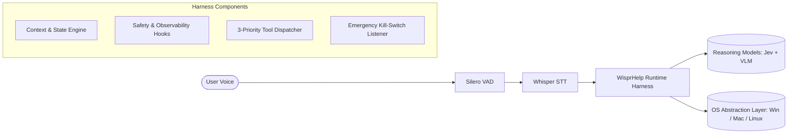

# Runtime Agent Harness Specification (`HARNESS.md`)

**Evidence note (2026-10-11):** historical design requirements and performance targets are not proof of implemented or validated behavior. See [EVALUATION_REPORT.md](EVALUATION_REPORT.md) for the current execution contract and platform evidence.

**Document Version:** 1.1.0  
**Target:** WisprHelp Runtime Engine & Execution Orchestrator  

---

## 1. Harness Concept & Purpose

An **Agent Harness** is the operating environment and execution wrapper that controls an AI model. While AI models (TypeSafe Jev, Claude 3.5, Gemini 2.5) act as the reasoning brains, the **WisprHelp Harness** acts as the operating system: managing state, enforcing safety guardrails, dispatching tools, sensing screen context, and handling interrupts.



---

## 2. The Execution Lifecycle

Every user request follows a deterministic 8-step lifecycle managed by the harness:

```
[1. Silero VAD Audio Trigger] ──► [2. Enrich OS Context] ──► [3. Jev System One] ──► [4. Guardrail Evaluation]
                                                                                            │
    ┌───────────────────────────────────────────────────────────────────────────────────────┘
    ▼
[5. 3-Priority Tool Dispatch] ──► [6. Action Execution] ──► [7. Screen Verification] ──► [8. Completion & Feedback]
```

### Detailed Lifecycle Steps:
1. **Silero VAD & Audio Capture**: Push-to-talk hotkey or voice trigger initiates local Silero VAD audio filtering. Audio is streamed to Whisper Large v3 upon voice pause.
2. **Context Enrichment**: Harness queries the active window sensor (`title`, `process_name`, `window_rect`) and operating system identifier (`windows`, `darwin`, `linux`).
3. **System One Reflex (TypeSafe Jev)**: Harness sends the user command + system context to Jev in one parallel multi-question call (~100-150ms). Jev responds with calibrated intent, target app, complexity score, and risk score.
4. **Guardrail & Confidence Evaluation**:
   - If `intent.confidence < 0.60`, harness pauses and routes to clarification.
   - If `is_destructive.noul > 0.65`, harness engages voice confirmation.
5. **3-Priority Tool Dispatch**:
   - **Priority 1**: Shell / Protocol / AppID / Direct CLI (instant execution).
   - **Priority 2**: OS Native Accessibility Tree (UIA/AX/AT-SPI) element matching.
   - **Priority 3**: System Two Multimodal ReAct loop with screen downscaling and VLM.
6. **Action Execution**: Physical mouse movement (bezier curves), clicks, scrolls, or keyboard strokes executed through the platform-specific OS adapter.
7. **Screen Verification**: Screen capture taken immediately after action to verify UI state change. If UI did not update, harness initiates retry or self-correction.
8. **Completion & Feedback**: PySide6 HUD updates, and an audio chime or spoken voice confirms completion to the user.

---

## 3. Harness Hook Points

The harness exposes core hook points for observability, safety, and extension:

```python
class AgentHarnessHooks:
    def pre_execution_hook(self, command: str, context: Dict[str, Any]) -> bool:
        """Called before any classification or action. Return False to abort."""
        pass

    def on_classification_hook(self, decision: JevClassificationResult) -> None:
        """Called when TypeSafe Jev classification returns."""
        pass

    def pre_action_hook(self, action_step: ActionStep) -> bool:
        """Called before every physical mouse click, keystroke, or system call."""
        pass

    def post_action_hook(self, action_step: ActionStep, screen_diff: float) -> None:
        """Called after an action executes to measure UI screen delta."""
        pass

    def emergency_abort_hook(self, reason: str) -> None:
        """Called instantaneously when mouse fling or Esc key is pressed."""
        pass
```

---

## 4. State Management & Context Budgeting

### Active State Model
The harness maintains an in-memory state dictionary tracking:
- `active_window`: Current focused window title and process ID.
- `session_history`: Up to 5 most recent user commands and outcomes.
- `current_step_count`: Step counter for Tier-2 tasks (strictly capped at 15 steps).
- `last_screenshot_timestamp`: Time of the last captured screen frame.

### Memory & Token Optimization
- **Screen Downscaling**: Screen frames sent to multimodal models are scaled to standard 1080p or 1440p normalized bounds via `PIL` to preserve vision tokens.
- **Diff Sensing**: The harness compares frame hashes before calling heavy vision models; if the screen has not changed, the harness avoids redundant visual analysis.

---

## 5. Failure Recovery & Self-Correction Policy

| Failure Condition | Harness Reaction |
|---|---|
| **Element Not Found in UIA (Priority 2)** | Harness cascades automatically to Priority 3 (Screen Grab + VLM). |
| **App Failed to Launch** | Harness falls back to system search (e.g. Windows Search / Spotlight / dmenu). |
| **Low Confidence Classification** | Harness speaks: *"I didn't quite catch that. Did you mean [Option A] or [Option B]?"* |
| **Emergency Abort Triggered** | Harness immediately cuts mouse/keyboard input and sounds an abort tone. |
